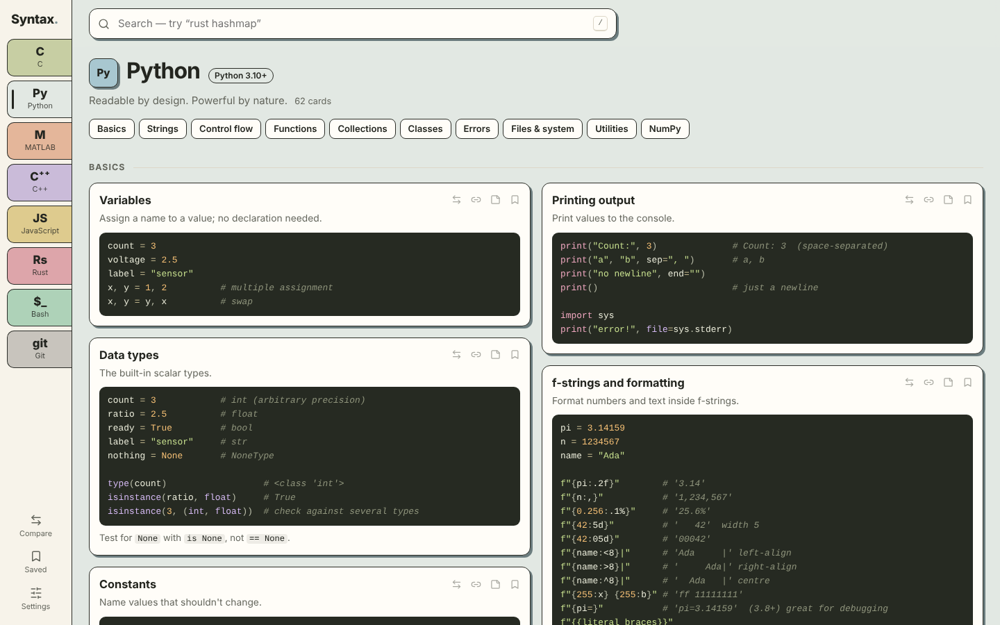

# Syntax

[Open Syntax](https://georgephilippou.github.io/syntax/) · [Source](https://github.com/GeorgePhilippou/syntax)

A personal, offline programming reference for **C, C++, Python, MATLAB, JavaScript, Rust, Bash and Git**: about 390 short cards, each with real code and the gotchas worth remembering. Examples in C, C++, Rust, Python, JavaScript and Bash are checked by real compilers and parsers on every build.



## Using it

- **Languages**: pick one from the left (or press `1`–`8`). Section buttons at the top jump down the page.
- **Search**: press `/` or `⌘K`. Search covers every language, your notes included. Start with a language name to narrow it: `rust hashmap`, `py slicing`, `git undo`. `Esc` clears the search.
- **Compare**: the ⇄ button on a card, or **Compare** in the sidebar, lines a concept up across the languages you pick.
- **Save and notes**: bookmark a card, or add your own note to it. Both show up under **Saved**.
- **Links**: every card has its own URL (`#/python/slicing`), so you can bookmark it in the browser, and the back button works.
- **Settings**: light or dark theme, text size, whether to show explanations, wrapping long code lines, and backup/restore of your saved cards and notes.

Saved cards, notes and settings live in your browser's local storage. Use **Settings → Download backup** now and then, because clearing site data deletes them.

## Adding or editing cards

All content is in `content/<language>.md`, one file per language. A card looks like this:

````markdown
# Collections                 ← category (section heading)

## Slicing                    ← card title
@id slicing                   ← optional; cards with the same id line up in Compare
@keywords substring reverse   ← extra words for search
@diff [start:stop:step]       ← one-line summary shown in Compare
@check body                   ← optional: how the example is compiled (see below)

Take part of a string or list.   ← first paragraph = summary

```python
s[1:4]
```

Anything after the code is the explanation. Supports `code`, **bold** and - lists.
````

`@check` controls how C, C++ and Rust snippets are wrapped for compilation: `body` puts the code inside `main` (the default unless the snippet already has a `main`), `top` puts it at file scope, `program` compiles it as-is, and `skip` leaves it unchecked. A code block in another language, such as a `bash` block inside a Rust card, isn't checked.

To add a whole new language, create `content/<id>.md` with front matter (`name`, `symbol`, `order`, `color`, `version`, `highlight`, `description`). If it needs syntax highlighting, add its Prism component in `src/lib/highlight.ts`. If it can be checked, add a checker in `tests/content.mjs`.

## Development

Requires Node.js 22+.

```sh
npm ci
npm run dev          # http://127.0.0.1:5173
npm test             # parse every card and compile/parse every example
npm run build        # production build in dist/
npm run test:offline # service-worker harness (after a build)
```

`npm test` uses `clang`/`clang++` (Xcode Command Line Tools), `rustc` (via [rustup](https://rustup.rs)), `python3` and `bash`. If one of them is missing locally, that language is skipped with a warning. CI sets `SYNTAX_STRICT=1` so a missing toolchain fails instead. MATLAB examples are reviewed by hand (no runtime available). Git cards are commands and aren't executed.

### Code layout

- `content/*.md`: the reference content.
- `src/content/parse.ts`: the Markdown card parser, shared by the app and the tests.
- `src/App.tsx`: layout, routing, keyboard shortcuts and stored state.
- `src/components/`: cards, code blocks, language page, search results, compare grid, saved view and settings.
- `src/lib/`: search, hash routing, highlighting, local storage and offline/service-worker helpers.
- `src/styles.css`: one stylesheet, with light and dark tokens. Each language's colour tints the page.
- `public/sw.js`: the offline cache. `scripts/version-worker.mjs` stamps it with a build hash.

## Deployment and offline use

Pushing to `main` runs `.github/workflows/pages.yml`, which tests, builds and deploys to GitHub Pages. Pull requests run the same checks without deploying.

After the first online visit, the service worker caches the whole app, so it works offline. To install it as an app: in Safari, **File → Add to Dock**; in Chrome, use the install icon in the address bar. When a new version is deployed, the app picks it up on the next visit and shows a notice to reload.
